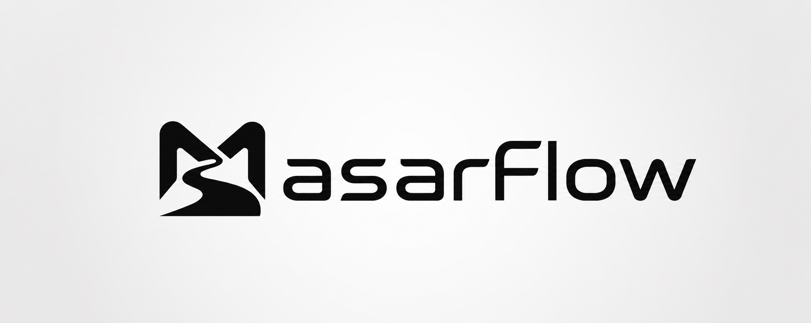

<p align="center">
  
</p>

**A local-first desktop workspace for planning and building software.** Notes, specs, tasks, docs and canvases live in one app, with an AI chat that can see all of it. No account, no cloud, no telemetry.

<p align="center">
  
  
  
  
  
  
</p>

---

## Install (Windows 10/11, x64)

1. Download `MasarFlow Setup 0.2.0.exe` from the [latest release](https://github.com/trookish/MasarFlow/releases/latest) and run it.
2. **SmartScreen:** the installer is unsigned, so Windows shows "Windows protected your PC" — choose *More info* → *Run anyway*. Download only from this repository's Releases page: an unsigned build cannot prove who produced it.

A portable `MasarFlow 0.2.0.exe` is also published (no installer, no auto-update). macOS and Linux builds are not produced for this release.

## First run

The setup wizard walks through: what MasarFlow is → create or open a project → link a folder with the native picker (only linked folders are readable by the app) → pick an AI provider (optional — no key is needed to use the workspace) → optionally import a MasarFlow 0.1 export.

## Migrating from MasarFlow 0.1

MasarFlow 0.1 stored data under a browser origin; 0.2 runs on `masarflow://app` and cannot read it. To migrate:

1. Install `v0.1.6.0` and use **Settings → Data → Export**.
2. In 0.2, pick that `.json` file in wizard step 5 (or **Settings → Data → Import**).

## What's inside

Six surfaces in the left sidebar. Each one groups related pages as sections.

- **Today** — overdue, due today, in progress and the inbox on one page, plus the Dashboard.
- **Capture** — notes (wikilinks, templates, daily notes), canvases and project files.
- **Work** — task boards, specifications, sprints and dev logs. Progress comes from task status only.
- **Library** — documentation, standards, architecture, the knowledge graph and local semantic search (no Python, no extra runtime).
- **Ask** — chat, AI agents and AI workflows on one runtime: native providers (OpenAI, Anthropic, OpenRouter, Groq, … from the models.dev catalog), local Ollama, or any OpenAI-compatible endpoint. Every AI write needs your approval and can be undone.
- **System** — settings, Control Center, git (status, diff, stage, commit), GitHub (issues ⇄ tasks, PR/CI status), Obsidian sync, project watcher, terminal and logs.

Every project keeps its own row of tabs above the content: pages you opened, the item selected on each, and recently closed tabs (Ctrl+Shift+T reopens). The inspector on the right shows the selected task, spec, note or doc with its properties and links, and hands it to Ask in one click. The command palette (Ctrl+K) reaches every page, entity and action.

## Where your data lives

- **Workspace data** — IndexedDB under the app origin (`masarflow://app`).
- **`%APPDATA%\MasarFlow`** — `logs/`, `backups/` (rolling, with retention), `secrets.json` (encrypted with the OS credential store), `roots.json` (the folders you linked).
- A plain-markdown **vault mirror** keeps notes, docs, specs and tasks as real files that Obsidian, VS Code and git can open.

**Settings → Data** exports/imports the workspace, restores backups and reveals the backup folder.

## Updates

In-app from GitHub Releases: check on launch or on demand, download when you ask, install on quit or via *Restart now*. The *Test* channel installs prereleases. Portable builds update manually.

## Privacy

No telemetry, no account, no analytics. The only outbound traffic is the AI provider you configure (plus GitHub when you use updates, issues or PRs). **Copy diagnostics** is the only thing we ever ask you to send, and it is redacted: no keys or tokens, and paths outside your linked folders are masked.

## Troubleshooting

| Symptom | Fix |
| --- | --- |
| SmartScreen warning | *More info* → *Run anyway* — the build is unsigned. |
| "workspace could not be opened" | Restore a backup (Settings → Data). |
| A folder can't be read | Link it again with the native picker — the allow-list is per machine. |
| Blank window | Check `%APPDATA%\MasarFlow\logs\server.log`, then use Copy diagnostics. |
| Update check fails offline | Expected — updates need GitHub reachability. |

## Development

```bash
pnpm install
pnpm dev            # the desktop app with HMR (Electron + next dev)
pnpm test           # Vitest unit tests
pnpm typecheck && pnpm desktop:typecheck && pnpm lint
pnpm desktop:dist:dir && pnpm smoke:desktop   # packaged smoke → SMOKE_OK
pnpm e2e:desktop    # packaged-app specs (run desktop:dist:dir first)
```

More detail: [docs/development.md](docs/development.md). Architecture and security model: [docs/architecture.md](docs/architecture.md).

## Security

The workspace service binds `127.0.0.1` only and every request must carry a per-launch token the renderer never sees; `Host` and `Origin` are checked (anti DNS-rebinding / anti CSRF); filesystem and shell routes only accept paths inside folders you picked with the native picker; Electron runs sandboxed with context isolation, a CSP and a navigation lock; API keys, the GitHub token and the Obsidian key are encrypted with the OS credential store. The Windows installer is **unsigned** — see the install note above. How to report a vulnerability, the full threat model and known limits: [SECURITY.md](SECURITY.md).

## Contributing

Single-developer project, but the rules are written down: [AGENTS.md](AGENTS.md) is the contract (feature-truth guards, tests before code, commit conventions). New features need a passing packaged spec; `pnpm e2e:desktop` is the target, `pnpm e2e` is a dev convenience.
